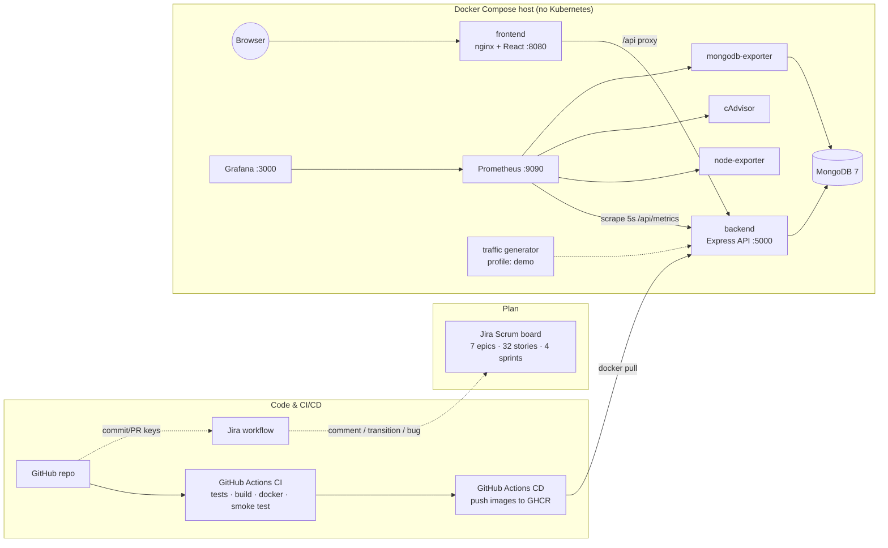

# ResourceHub — Office Resource Management System

> **Agile Software Development & DevOps Lab project**
> React · Node.js/Express · MongoDB · **Docker & Docker Compose** · **GitHub Actions (CI/CD)** · **Prometheus** · **Grafana** · **Jira**
> *No Kubernetes — the whole platform runs with one `docker compose up` command.*

ResourceHub tracks every laptop, monitor, phone, printer, meeting room and projector in an office.
Employees request assets and book rooms, admins approve and allocate, broken equipment goes through a
maintenance workflow, and every action is audited. The DevOps toolchain plans the work in **Jira**,
tests and ships it with **GitHub Actions**, runs it in **Docker**, and watches it with **Prometheus + Grafana**.

---

> 👉 **New here? Read [`START_HERE.md`](START_HERE.md) first.** It covers running the app, pushing to GitHub, and the live Jira board at https://aravpalod2.atlassian.net (project ORMS).

## 1. Quick start (2 commands)

Prerequisite: **Docker Desktop** (Windows/macOS) or Docker Engine + Compose v2 (Linux).

```bash
cp .env.example .env            # Windows PowerShell: Copy-Item .env.example .env
docker compose up -d --build    # first build takes ~3–5 min
```

Or use the start scripts: `./scripts/start.sh` (Linux/macOS/Git Bash) · `.\scripts\start.ps1` (PowerShell).

| What | URL | Login |
|---|---|---|
| **Web app** | http://localhost:8080 | `admin@resourcehub.com` / `Admin@123` · `employee@resourcehub.com` / `Employee@123` |
| **API health** | http://localhost:5000/api/health | – |
| **API metrics** | http://localhost:5000/api/metrics | – |
| **Prometheus** | http://localhost:9090 (targets: `/targets`, alerts: `/alerts`) | – |
| **Grafana** | http://localhost:3000 | `admin` / `admin` (anonymous read-only also enabled) |

**Make the dashboards move** — start the synthetic-traffic container (simulates employees logging in,
booking rooms, creating conflicts, requesting laptops, failed logins …):

```bash
docker compose --profile demo up -d
```

Demo data (7 users, 21 resources, bookings, requests, tickets) is seeded automatically on first start.
Stop with `docker compose down` (add `-v` to wipe the database and dashboards' history).

👉 **Presenting this project? Follow [`docs/DEMO_GUIDE.md`](docs/DEMO_GUIDE.md)** — a 10-minute script for the viva.

---

## 2. Architecture



| Container | Image | Purpose |
|---|---|---|
| `rh-frontend` | built from `frontend/Dockerfile` (multi-stage → nginx) | React SPA; nginx reverse-proxies `/api` to the backend (same origin, no CORS) |
| `rh-backend` | built from `backend/Dockerfile` (multi-stage, non-root) | REST API, JWT auth, RBAC, business rules, `/api/metrics` |
| `rh-mongo` | `mongo:7.0` | Database (named volume `mongo-data`) |
| `rh-prometheus` | `prom/prometheus:v2.54.1` | Scrapes 6 targets, evaluates 16 alert/recording rules |
| `rh-grafana` | `grafana/grafana:11.2.0` | 2 auto-provisioned dashboards (60 panels) |
| `rh-node-exporter` | `prom/node-exporter` | Host CPU / RAM / disk / network |
| `rh-cadvisor` | `gcr.io/cadvisor/cadvisor` | Per-container CPU / RAM / network |
| `rh-mongodb-exporter` | `percona/mongodb_exporter` | MongoDB connections, ops/sec, memory |
| `rh-traffic` *(demo profile)* | `node:22-alpine` | Synthetic users so graphs are alive |

Three Docker networks isolate tiers: `frontend-net`, `backend-net` (DB only reachable by the API/exporter) and `monitoring-net`.

### What replaces Kubernetes?
| Kubernetes feature (friend's version) | Our Docker Compose equivalent |
|---|---|
| Deployments / self-healing pods | `restart: unless-stopped` + Docker `HEALTHCHECK` |
| Readiness probes / ordered start-up | `depends_on: condition: service_healthy` |
| Services / kube-DNS | Compose service names on user-defined networks (`backend:5000`) |
| Ingress | nginx in the frontend container proxies `/api` |
| ConfigMap / Secret | `.env` file + `environment:` (`.env` is git-ignored) |
| Prometheus/Grafana pods | Same tools as compose services with file-based provisioning |
| `kubectl apply -k` | `docker compose up -d` |

---

## 3. Features

| | Admin | Employee |
|---|:-:|:-:|
| Sign up (always creates EMPLOYEE — role in payload is ignored) | – | ✅ |
| Dashboard with charts | org-wide | personal |
| Add / edit / retire / delete resources | ✅ | ❌ (403) |
| Request an asset | – | ✅ |
| Approve (→ atomic allocation) / reject requests | ✅ | ❌ |
| Allocate directly, check in returns (GOOD / DAMAGED → auto ticket) | ✅ | request return only |
| Book rooms & projectors on a day-view calendar | ✅ | ✅ |
| Cancel bookings | any | own only |
| Report faults (resource → UNDER_MAINTENANCE) | ✅ | shared + own assets |
| Progress / resolve tickets (restores status) | ✅ | ❌ |
| Users management, audit log | ✅ | ❌ |
| In-app notifications, profile, live Monitoring page | ✅ | ✅ |

**Key business rules (all covered by tests)**
- **Booking overlap**: `[s1,e1)` and `[s2,e2)` clash iff `s1 < e2 AND s2 < e1` → `409 Conflict`; back-to-back slots are allowed; no past bookings; capacity check; max 10 h.
- **No double allocation**: `AVAILABLE → ALLOCATED` is a single conditional `findOneAndUpdate`, so two simultaneous approvals cannot both succeed. Competing pending requests are auto-rejected.
- **Maintenance** remembers the previous state and restores `ALLOCATED`/`AVAILABLE` on resolve; one open ticket per resource.

---

## 4. Monitoring (Prometheus + Grafana)

The API exposes **`GET /api/metrics`** (prom-client). Highlights:

| Metric | Type | Meaning |
|---|---|---|
| `rh_http_requests_total{method,route,status_code}` | counter | Traffic & errors (route label is the Express *pattern*, so IDs don't explode cardinality) |
| `rh_http_request_duration_seconds` | histogram | Latency → p50/p95/p99 |
| `rh_http_requests_in_flight` | gauge | Saturation |
| `rh_logins_total{result}` | counter | Successful / failed logins |
| `rh_bookings_total{outcome}` | counter | confirmed / **conflict** / cancelled |
| `rh_resource_requests_total{action}`, `rh_allocations_total{action}`, `rh_maintenance_tickets_total{priority}` | counter | Workflow events |
| `rh_resources{status,category}`, `rh_resource_requests{status}`, `rh_allocations{status}`, `rh_maintenance_tickets{status,priority}`, `rh_bookings_today`, `rh_asset_utilization_ratio`, `rh_users` | gauge | **Live business state read from MongoDB at scrape time** (cached 5 s) |
| `rh_db_up` | gauge | API ↔ MongoDB connectivity |
| `rh_process_*`, `rh_nodejs_*` | various | CPU, heap, event-loop lag, GC |

**Grafana dashboards** (provisioned from `monitoring/grafana/`, generated by `scripts/grafana/build_dashboards.py`):
1. **ResourceHub – Application Overview** (`/d/resourcehub-overview`, home dashboard): service health stats, request rate by route, status codes, latency percentiles, errors by route, business KPIs, asset utilisation gauge, resources by status/category, booking conflicts, login failures, Node.js runtime.
2. **ResourceHub – Infrastructure & Containers** (`/d/resourcehub-infra`): scrape-target table, firing alerts, host CPU/RAM/disk/network, per-container CPU/memory, MongoDB.

**Alert rules** (`monitoring/prometheus/alert.rules.yml`, see http://localhost:9090/alerts): API down, DB disconnected, exporter down, 5xx > 5 %, p95 > 500 ms, heap > 90 %, event-loop lag, **critical maintenance ticket open** (fires with the demo data), request backlog, booking-conflict spike, brute-force logins, host CPU/RAM.

Details: [`docs/MONITORING.md`](docs/MONITORING.md).

---

## 5. CI/CD (GitHub Actions)

| Workflow | Trigger | Jobs |
|---|---|---|
| [`ci.yml`](.github/workflows/ci.yml) | push / PR | **backend** (lint + 24 tests on an ephemeral MongoDB service) → **frontend** (Vite build, artifact) → **monitoring** (`promtool check`, dashboards JSON + generator drift, `docker compose config`) → **docker** (Buildx build both images, GHA cache) → **smoke-test** (boots the *entire* compose stack, logs in through nginx, runs traffic, asserts Prometheus target is UP and metrics ingested, asserts Grafana datasource healthy and both dashboards provisioned) |
| [`cd.yml`](.github/workflows/cd.yml) | push to `main`, tags `v*` | Multi-arch images → **GHCR** (`latest`, `sha-xxxx`, semver) + GitHub Release on tags |
| [`jira.yml`](.github/workflows/jira.yml) | push, PR, CI completed | Comments commits/PRs on Jira issues, PR opened → *In Review*, merged → *Done*, CI failure on `main` → auto-creates a Jira **Bug** |

Details: [`docs/CI_CD.md`](docs/CI_CD.md).

---

## 6. Agile with Jira

- Backlog as code: [`jira/backlog.json`](jira/backlog.json) — **7 epics, 32 user stories, 118 story points, 4 two-week sprints**, each story with acceptance criteria and owner role.
- **Live board:** https://aravpalod2.atlassian.net, project **ResourceHub (ORMS)**. Sprints 1–3 are completed and Sprint 4 is active. The issue map is in [`jira/created_issues.json`](jira/created_issues.json).
- To recreate it on another site: `python3 scripts/jira/create_backlog.py --sprints`, or import [`jira/backlog.csv`](jira/backlog.csv).
- Branch / commit / PR convention: `feature/ORMS-12-booking-overlap`, `ORMS-12 reject overlapping bookings` → the Jira workflow links everything.

Setup guide (API token, GitHub secrets, GitHub-for-Jira app, Atlassian MCP): [`docs/JIRA.md`](docs/JIRA.md).

---

## 7. Repository layout

```
resourcehub/
├── .github/
│   ├── workflows/ ci.yml · cd.yml · jira.yml
│   ├── pull_request_template.md · ISSUE_TEMPLATE/ · dependabot.yml
├── backend/                     Express API (ES modules)
│   ├── src/
│   │   ├── config/              env.js, db.js (retrying connect)
│   │   ├── models/              User, Resource, ResourceRequest, Allocation, Booking, Maintenance, Notification, ActivityLog
│   │   ├── services/            business rules (booking overlap, atomic allocation, maintenance, audit)
│   │   ├── controllers/         thin HTTP handlers
│   │   ├── routes/index.js      full route map with RBAC guards
│   │   ├── middleware/          auth (JWT + roles), errors
│   │   ├── metrics/metrics.js   Prometheus instrumentation
│   │   ├── seed/seed.js         demo data (auto on first start)
│   │   └── app.js · server.js   /api/health, /api/metrics, graceful shutdown
│   ├── tests/                   node:test + supertest (auth, workflow, booking, metrics)
│   └── Dockerfile
├── frontend/                    React 18 + Vite + Tailwind + Recharts
│   ├── src/pages/               Dashboard, Resources, Requests, Allocations, Bookings, Maintenance, Users, Activity, Monitoring, Profile, Auth
│   ├── src/components/          Layout (sidebar, notifications), ui kit
│   ├── nginx.conf · Dockerfile
├── monitoring/
│   ├── prometheus/              prometheus.yml · alert.rules.yml
│   └── grafana/                 provisioning/ (datasource, dashboard provider) · dashboards/*.json
├── jira/                        backlog.json · backlog.csv
├── scripts/
│   ├── traffic-generator.js     synthetic load for demos
│   ├── grafana/build_dashboards.py   dashboards as code
│   ├── jira/                    jira_client.py · jira_sync.py (CI) · create_backlog.py
│   └── start.sh · start.ps1
├── docs/                        DEMO_GUIDE · ARCHITECTURE · API · MONITORING · CI_CD · JIRA · VIVA_QA
├── docker-compose.yml
└── .env.example
```

---

## 8. Local development without Docker

```bash
# MongoDB on localhost:27017 is required (e.g. `docker run -d -p 27017:27017 mongo:7.0`)
cd backend  && npm install && npm run dev        # http://localhost:5000
cd frontend && npm install && npm run dev        # http://localhost:5173 (proxies /api to :5000)
cd backend  && npm test                          # 24 tests
```

`npm run seed -- --reset` wipes and reseeds the demo data.

---

## 9. Team

| Member | Role |
|---|---|
| _Name 1_ | Scrum Master · DevOps & Backend |
| _Name 2_ | Frontend & UI/UX |
| _Name 3_ | Business logic · Testing & QA |
